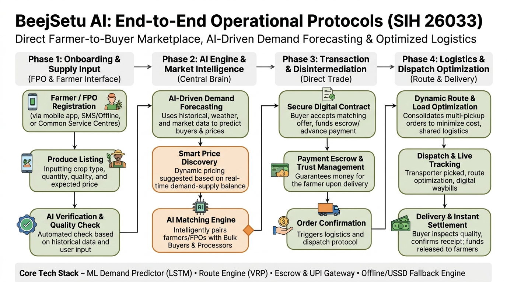

# Smart India Hackathon Workshop
# Date: 24/11/2026
## Reference Number: 26018692
## Name: ASHIK BASHA. A

## Problem Title
SIH 26033: Multiple intermediaries reduce farmers earnings and increase consumer prices.

## Problem Creater's Organization
Ministry of Consumer Affairs, Food & Public Distribution

## Theme
Agriculture, FoodTech & Rural Development

## Problem Description
Expected Solution: Create a digital marketplace that:

• Connects farmers/FPOs directly with consumers and bulk buyers.
• Provides logistics support.
• Uses AI for demand forecasting and route optimization.

Benefits:

• Better prices for farmers.
• Lower prices for consumers.
• Reduced supply chain inefficiencies.

## Proposed Solution

### 1. Detailed Explanation of the Proposed Solution

Beet setu AI is an all-in-one, local-language voice-first AI platform that eliminates intermediaries across the
entire farming lifecycle—from seed selection and peer mentorship to direct wholesale delivery to local retail
shops and consumers. Built on India's Bhashini multilingual voice stack and AgriStack farmer registries, the app
features an ultra-simple, icon-and-voice interface that any farmer can operate effortlessly in their native
language through five core modules:

* AI Plant Variety Advisor: Analyzes local soil health, micro-climate forecasts, and upcoming buyer demand to
recommend the most profitable, disease-resistant plant varieties before sowing.

* Farmer-to-Farmer (F2F) Direct Seed Sharing Network: Cuts out private seed brokers and inflated retail markups by connecting neighboring farmers to directly share, barter, or buy quality seeds and saplings with verified germination ratings.

* Peer Mentorship ("Lead Farmer / Kisan Guru" Clusters): Connects small and marginal farmers directly under experienced, knowledgeable Lead Farmers in their village who guide them on sowing, pest control, and uniform quality standards while pooling their harvests into wholesale-ready lots.

* Direct Wholesale-to-Shop & Consumer Marketplace: Enables Lead Farmer clusters and FPOs to sell wholesale directly to local retail shops (kirana stores, supermarkets, HoReCa) and urban consumers—cutting out mandi agents (arhtiyas) and commission middlemen for maximum farmer profit.

* AI Demand Forecasting & Shared Route-Optimized Logistics: Predicts hyperlocal shop and consumer demand 7 to 14 days in advance and schedules shared mini-truck milk-runs to pick up pooled village harvests and deliver them directly to shops along the shortest route.

### 2. How It Addresses the Problem

* Eliminates Both Input & Output Intermediaries: Cuts middlemen at the start of the cycle (via direct Farmer-to-Farmer seed sharing) and at the end of the cycle (via direct wholesale-to-shop selling), increasing farmer net profits by 30% to 45% while lowering shop procurement and consumer prices by 15% to 25%.

* Empowers Small Farmers with Collective Scale & Knowledge: Guided by experienced Lead Farmers, smallholders grow market-demanded varieties to uniform quality and pool micro-harvests together—unlocking direct wholesale access to retail shops that individual small farmers could never reach alone.

* Removes Language & Digital Literacy Barriers: Replaces complex text menus with conversational regional voice commands (Tamil, Hindi, Telugu, Marathi, Kannada, etc.) and visual icons so every farmer can check plant varieties, request seeds, consult their Lead Farmer, and confirm wholesale shop orders hands-free.

### 3. Innovation and Uniqueness of the Solution

* Seed-to-Shop End-to-End Integration: Unlike standalone marketplaces that only intervene after harvest, BeejSetu AI aligns plant variety selection and F2F seed sharing directly with forecasted wholesale shop demand—preventing overproduction and distress sales before crops are even planted.

* Human-in-the-Loop Peer Mentorship + AI: Combines local agricultural wisdom with AI intelligence by pairing small farmers with trusted village Lead Farmers who earn micro-incentives on successful collective wholesale deliveries, ensuring high adoption and consistent produce quality.

* Vernacular Voice-First UX with One-Tap Shop Fulfilment: Leverages real-time Indian language speech recognition and voice synthesis alongside instant UPI escrow payouts, turning a basic smartphone into a complete digital storefront, seed exchange, and AI agronomist. 

## Technical Approach

### 1. Technologies to Be Used

"Frontend & Vernacular User Experience"

* React Native / Flutter (with Offline SQLite Sync): Builds a lightweight, icon-driven mobile app that stores data locally and syncs automatically in low-network villages.

* Bhashini API (Speech-to-Text & Text-to-Speech): Powers real-time regional voice commands and audio guidance across Indian languages so any farmer can operate the app effortlessly.

* Exotel IVR & SMS Gateway: Enables basic feature-phone access through automated voice calls and SMS alerts for order confirmations.

"Backend & Digital Commerce"

* Python (FastAPI) & Node.js: High-performance backend microservices managing F2F seed sharing, Lead Farmer clusters, and direct wholesale shop orders.

* PostgreSQL + PostGIS & Redis: Geospatial database for matching nearby farms, Lead Farmers, and local retail shops with real-time inventory caching.

* ONDC Beckn Protocol: Ensures open-network interoperability so village harvests can reach broader institutional and retail buyer networks.

* RazorpayX / UPI Smart Escrow: Holds buyer payments securely and releases instant 100% UPI payouts directly to farmers' bank accounts upon delivery scan.

"AI / ML & Route Optimization"

* XGBoost / LightGBM + RAG (ICAR & Soil Health Data): Recommends the highest-yielding, disease-resistant plant varieties tailored to local soil and micro-climate conditions.

* Temporal Fusion Transformer (TFT): Forecasts hyperlocal shop and consumer demand 7 to 14 days in advance to prevent overproduction and price crashes.

* Google OR-Tools (CVRPTW): Solves multi-stop vehicle routing to optimize shared mini-truck milk-runs from village pickup hubs directly to retail shops.

* MobileNetV3 / YOLOv8: Runs lightweight on-device smartphone computer vision to verify seed quality and grade harvested produce (Grade A/B/C).

"Hardware, IoT & Cloud Infrastructure"

* Basic Android Smartphones & Batch QR Tags: Enables instant camera quality scans and end-to-end farm-to-shop traceability without expensive hardware.

* GPS & BLE Temperature Sensors: Tracks shared delivery vehicles in real time and sends alerts to prevent perishable spoilage during transit.

* AWS / NIC MeghRaj Cloud: Provides secure, auto-scaling cloud deployment for high-volume peak harvest traffic.

### 2. Methodology and Process for Implementation End-to-End Operational Workflow (Flowchart Logic)

* Vernacular Onboarding & Soil/Location Profiling: Farmers and local retail shopkeepers register via Aadhaar/UPI e-KYC using regional voice prompts; the system fetches village micro-climate and Soil Health Card parameters.

* AI Plant Variety Recommendation: Before sowing, the AI Variety Advisor recommends high-yield, disease-resistant plant varieties aligned with local soil conditions and upcoming wholesale shop demand.

* Farmer-to-Farmer (F2F) Direct Seed Sharing: Farmers browse or request verified seeds and saplings from neighboring growers via voice search, eliminating private seed brokers and retail markups.

* Lead Farmer ("Kisan Guru") Mentorship & Lot Pooling: Small farmers are grouped under an experienced village Lead Farmer who shares cultivation guidance, conducts pre-harvest quality checks, and aggregates micro-harvests into wholesale-ready crates tagged with batch QR codes.

* AI Demand Forecasting & Direct Wholesale-to-Shop Matching: Time-series demand models aggregate recurring orders from local kirana stores, supermarkets, HoReCa, and consumers, locking buyer funds into a smart UPI escrow account.

* Route-Optimized Milk-Run Pickup & Instant Payout: Google OR-Tools computes the shortest multi-farm pickup to retail-shop delivery route for shared mini-trucks; QR scan upon shop delivery triggers instant UPI settlement to each participating farmer.

## Feasibility and Viability

### 1. Analysis of Feasibility

* Technical Feasibility: Built entirely on mature, open-source AI and geospatial frameworks (XGBoost, Google OR-Tools, PostGIS) integrated with India's established Digital Public Infrastructure—Bhashini for 22+ Indian languages, UPI for zero-delay bank transfers, and open AGMARKNET/Soil Health Card data. Offline-first local storage guarantees usability in low-connectivity villages.

* Operational & Financial Viability: Operates on an asset-light community-aggregator model—empowering existing village Lead Farmers as local quality hubs and partnering with regional mini-truck operators instead of purchasing vehicles or warehouses. Revenue is generated through a nominal 1.5% to 2.5% platform and logistics facilitation fee charged to wholesale retail shops and bulk buyers, keeping F2F seed sharing and farmer listings 100% commission-free.

### 2. Potential Challenges and Risks

* Digital Literacy & App Hesitation: Small and marginal farmers may feel intimidated by smartphone interfaces or skeptical of digital transactions.

* F2F Seed Germination & Purity Disputes: Peer-shared seeds could vary in germination rates if unverified, risking crop yield loss.

* Produce Quality Inconsistency: Individual smallholders may harvest uneven grades, leading to disputes or rejections from wholesale retail shops.

* Initial Supply-Demand Imbalance: Early pilot zones may face sparse pickup density, increasing per-kilometer transport costs.

### 3. Strategies for Overcoming These Challenges

* Voice-First UI + Lead Farmer Assisted Onboarding: Replace complex menus with conversational regional voice commands and visual icons, supported by trusted village Lead Farmers who guide neighboring smallholders through onboarding and order confirmation.

* Smartphone Seed Verification & Peer Reputation Ledger: Require photo-based seed inspection and post-sowing germination ratings on every F2F seed exchange, with escrow funds released only after buyer verification.

* Standardized Lead Farmer Grading & Sealed QR Crates: Equip Lead Farmers with simple visual grading checklists (Grade A/B/C) and QR-sealed crates so retail shops receive uniform, verified wholesale lots.

* Anchor Retail Shop Pre-Onboarding: Lock in recurring daily demand from local kirana associations, supermarkets, and institutional kitchens first so farmers cultivate against confirmed wholesale orders along dense delivery routes.

## Impact and Benefits

### 1. Potential Impact on Target Audienc

* Small & Marginal Farmers: Increases net farmgate profit by 30% to 45% by eliminating both seed middlemen and mandi commission agents (arhtiyas), while cutting seed input costs by 15% to 20% via direct F2F seed sharing.

* Knowledgeable Lead Farmers ("Kisan Gurus"): Unlocks steady aggregation and mentorship incentives while securing high-volume wholesale contracts through collective village supply.

* Local Retail Shops & Everyday Consumers: Reduces wholesale shop procurement and retail consumer prices by 15% to 25%, delivering fresher, farm-origin-traceable produce directly to neighborhood stores.

### 2. Multi-Dimensional Benefits

* Economic Benefits: Keeps agricultural margins within rural communities, reduces price volatility for essential perishables, and builds verifiable digital sales histories that improve small farmers' eligibility for Kisan Credit Cards (KCC) and formal bank loans.

* Social Benefits: Democratizes expert agronomy knowledge through village-level peer mentorship, eliminates language barriers with native voice AI, and strengthens collective bargaining power for smallholders.

* Environmental Benefits: Cuts post-harvest perishable food spoilage by 20% to 30% via rapid direct farm-to-shop transit, promotes climate-resilient and locally adapted plant varieties, and lowers transport fuel emissions by 18% to 22% through shared, route-optimized mini-truck milk-runs.

## Research and References

1. Link: https://www.rbi.org.in/Scripts/BS_ViewBulletin.aspx?Id=22326
2. Links: https://agmarknet.gov.in/ | https://www.pib.gov.in/PressReleasePage.aspx?PRID=2204750
3. Link: https://www.pib.gov.in/PressReleaseIframePage.aspx?PRID=2010600
4. Link: https://bhashini.gov.in/
5. Links: https://seed.iihr.res.in/ | https://www.icar.org.in/
6. Link: https://www.researchgate.net/publication/398729581_AI-Enhanced_Supply_Chain_Management_in_Agriculture

## IMAGE
